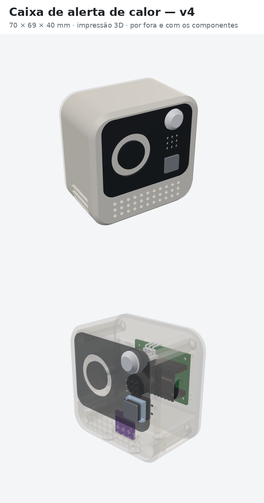
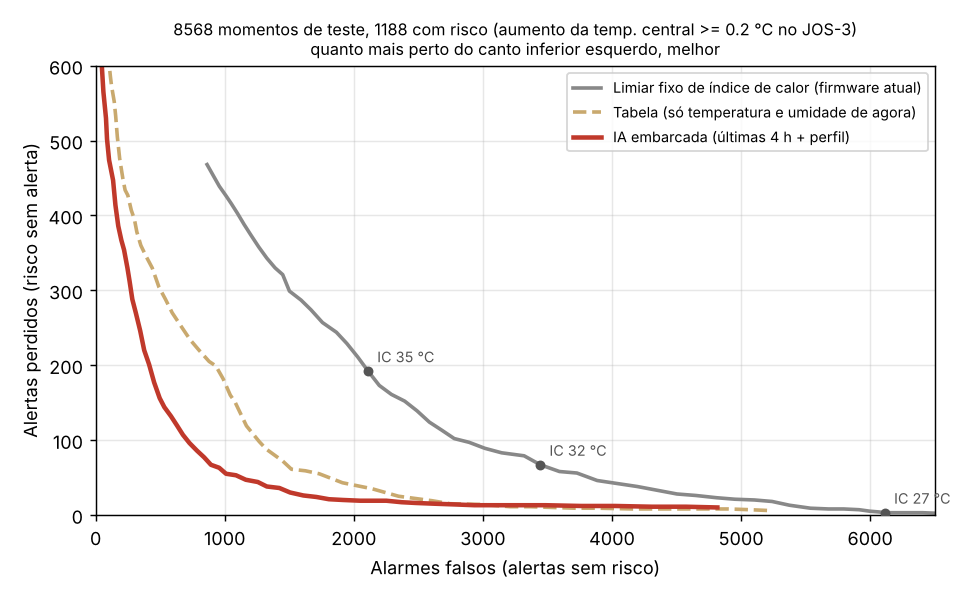

# Alerta de calor com IA para idosos

Uma caixa de baixo custo (meta: menos de R$ 60), ligada na tomada do quarto, que estima como o calor daquele cômodo está afetando o corpo de idosos e avisa o cuidador antes de o risco virar emergência, mesmo sem internet.

<p align="center"></p>

Projeto de Guilherme de Oliveira Pontes Pinto e Matheus Henrique Ferreira Pimentel (Sistemas de Informação, IFAL, Campus Maceió), com orientação do prof. Elvys Soares e coorientação do prof. Edison Camilo.

## O problema

- No Brasil, foram cerca de 48 mil mortes em excesso associadas ao calor entre 2000 e 2018, concentradas em idosos e em quem tem menos como se proteger (Monteiro dos Santos et al., 2024).
- Em Maceió, os dias mais quentes (máxima no percentil 95) aumentam em 5,2% as internações de idosos pelo SUS (2015–2024), mas nenhuma das 99.759 internações foi registrada como efeito do calor. Ver [`analise_maceio/`](analise_maceio/).
- O perigo está dentro de casa e das instituições de longa permanência (ILPIs), onde ninguém mede a temperatura e o idoso sente menos o calor.

## Como funciona

| Parte | O que faz | Situação |
|---|---|---|
| **Caixa** (ESP32 + sensor de temperatura e umidade) | Mede o cômodo, calcula o nível de risco e avisa com luz, som e Telegram. O alerta local funciona sem internet. Configuração pelo celular, como um roteador. | Testada em bancada |
| **IA 1: risco no corpo** (na própria caixa) | Rede neural de 2 KB que imita o modelo fisiológico JOS-3: usa as últimas 4 horas de leituras e o perfil de quem está no quarto (acamado, em repouso ou ativo) e estima o aumento da temperatura central e a perda de água por suor. | Prova de conceito pronta |
| **IA 2: assistente do cuidador** (nuvem) | Modelo de linguagem no Telegram ou WhatsApp que conhece os dados da caixa e a previsão do tempo e orienta o que fazer, sem dar diagnóstico. | Em construção |

Detalhes no [documento técnico de implementação da IA](docs/Implementacao_IA_Alerta_de_Calor.pdf) e na [proposta](docs/Proposta_AI4Good_Alerta_de_Calor.pdf).

## Resultados da IA na caixa (prova de conceito)

Teste em 8.568 momentos de simulações que a rede nunca viu, 1.188 deles com risco (aumento de pelo menos 0,2 °C na temperatura central segundo o JOS-3; limite provisório):

| Método | Alertas perdidos | Alarmes falsos |
|---|---:|---:|
| Limite fixo de índice de calor de 32 °C | 67 | 3.445 |
| Tabela com temperatura e umidade do momento | 220 | 801 |
| **IA na caixa (últimas 4 h + perfil)** | **86** | **784** |

Com quase a mesma sensibilidade do limite fixo, a IA dá **77% menos alarmes falsos**. Com o mesmo número de alarmes falsos da tabela, ela **perde 61% menos alertas**. O código em C dá o mesmo resultado que o Python (diferença máxima de 1,5 × 10⁻⁶ °C).

<p align="center"></p>

**Limitação importante:** a IA aprende o JOS-3, não pessoas reais. O JOS-3 tem incerteza para idosos, e os limites de risco ainda serão calibrados com dados reais.

## Estrutura do repositório

| Pasta | Conteúdo |
|---|---|
| [`firmware/`](firmware/) | Firmware de bancada (ESP32 DevKit, Etapa 11), módulo da IA (`ia_embarcada.h`, `modelo_risco.h`) e testes de bancada |
| [`ia/`](ia/) | Geração das simulações JOS-3, treino, avaliação, verificação do C, dados e figuras |
| [`assistente/`](assistente/) | Assistente do cuidador: esquema do banco, regras de segurança e perguntas de teste |
| [`caixa_3d/`](caixa_3d/) | Caixa v4 para impressão 3D (STL) e imagens com medidas |
| [`hardware/`](hardware/) | Placa de circuito no KiCad, mapa da protoboard e tutorial de montagem da bancada |
| [`analise_maceio/`](analise_maceio/) | Calor x internações de idosos em Maceió (SIH/SUS + INMET, 2015–2024) |
| [`docs/`](docs/) | Proposta e documento técnico da IA (PDF) |

## Como reproduzir

**Firmware:** ver [`firmware/README.md`](firmware/README.md).

**IA:**

```bash
cd ia
pip install -r requirements.txt
gunzip -k dados/sims.jsonl.gz                     # ou gere de novo: python gerar_simulacoes.py 400 dados/sims.jsonl
python treinar.py dados/sims.jsonl                # treina e gera modelo_risco.h
python avaliar.py 0.2 99999                       # detecção de risco e figuras
python verifica_c.py                              # compara o C com o Python
```

## Segurança e privacidade

Nenhum token, chat ID ou senha fica no código: o Wi-Fi, o bot do Telegram e o painel são configurados pela página da própria caixa e gravados na memória dela. Não versionamos dados de pessoas.

## Licença

[MIT](LICENSE).
