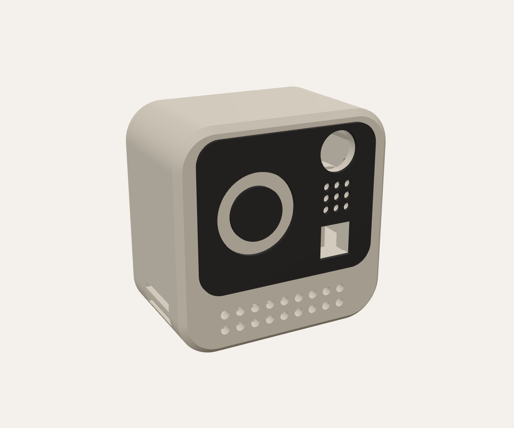
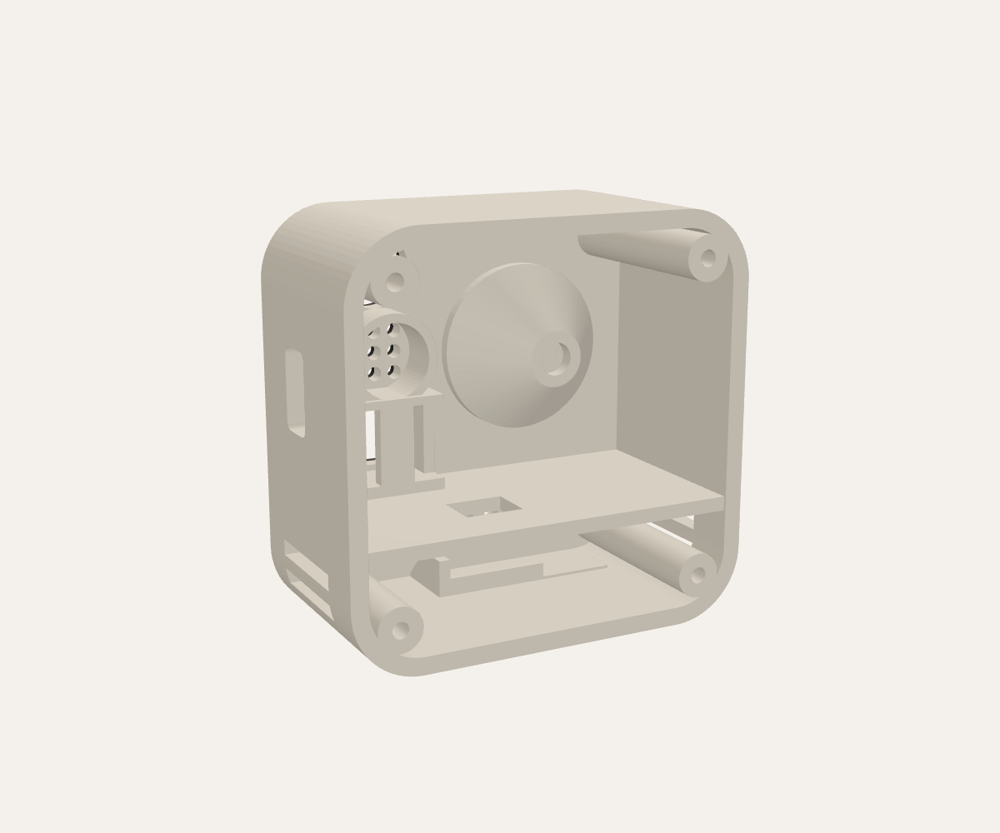
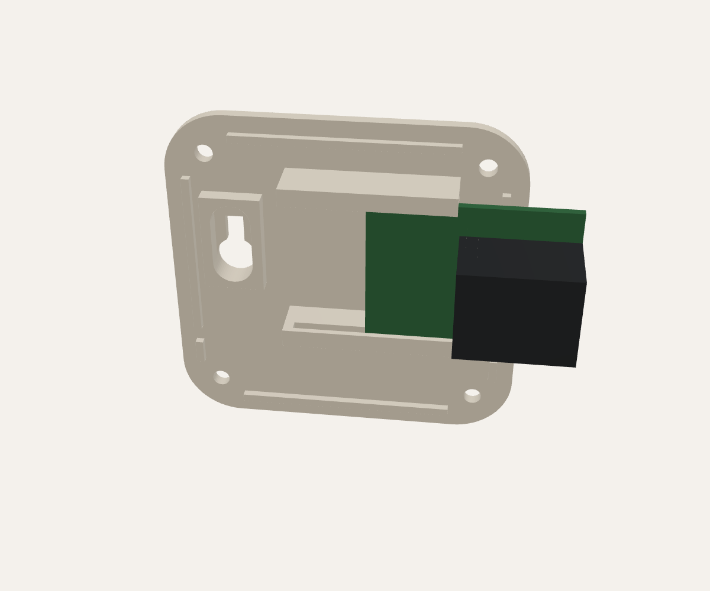

# Caixa v5 (70 × 69 × 40 mm), para ABS

  
  
  

Mesmo tamanho e mesma aparência da v4. A v4b foi desenhada para PETG/Tritan e, impressa em ABS, teve detalhes finos falhando, paredes rachando, suportes difíceis de tirar e encaixes apertados. A v5 foi refeita para o ABS.

## O que mudou da v4b para a v5

| Problema na v4b | Mudança na v5 |
|---|---|
| Suporte difícil de tirar na frente | A frente agora é lisa e fica inteira na mesa. O painel preto é colado por cima, alinhado pelos furos. O copo de luz virou um funil a 45° (o fundo plano era uma ponte de 25 mm). |
| Paredes frágeis, rachando | Paredes de 3,0 mm (eram 2,4), divisória de 2,4 mm, bossas dos parafusos mais grossas |
| Detalhes finos falhando | Sem presilhas de 1,3 mm nem nervuras de aperto. Furos de ventilação Ø2,8 (eram Ø2,2), furos do buzzer Ø2,4 (eram Ø1,8), pele do anel de luz de 0,8 mm (era 0,6) |
| Furos externos apertados | PIR Ø12,8 (era 12,4 com nervuras), LED Ø5,6 (era 5,2), botão 10,9 mm (era 10,5), USB-C 8 × 13,5 mm (era 7 × 12,5) |
| Placa e presilhas apertadas | A placa de circuito desliza em dois trilhos na tampa, com 0,4 mm de folga. Ela desceu 1 mm, porque na v4b o canto encostava numa bossa. |
| Tampa apertada | Ressalto de centralização com 0,4 mm de folga, furos dos parafusos Ø3,6 (eram 3,4) e furos guia Ø2,8 para M3 autoatarraxante em ABS (eram 2,5) |
| AHT20 e buzzer | Rasgo do AHT20 de 2,3 mm (era 1,9). Copo do buzzer liso, Ø12,9 (era com nervuras de aperto) |

O que ficar folgado leva uma gota de cola quente: lente do PIR, buzzer, LED.

## Arquivos

- `imprimir/`: STL já deitados na posição de impressão.
  - `caixa_alerta_corpo_v5.stl`, `caixa_alerta_tampa_v5.stl`: em ABS claro.
  - `caixa_alerta_painel_v5.stl`, `caixa_alerta_disco_v5.stl`: em ABS preto.
  - `teste_encaixes_v5.stl`: peça de teste rápida com os furos e rasgos da caixa.
- `codigo/`: scripts que geram as peças (`caixa_v5.py`, `bercos_v5.py`, `teste_encaixes_v5.py`). `caixa_v5.py` também confere as colisões entre a caixa, a tampa, a placa, o ESP32 e o plugue USB.
- `antigas/v4b/`: a versão anterior.

## Antes de tudo: imprima o teste

`teste_encaixes_v5.stl` leva uns 20 minutos. Confira nele:
- a lente do PIR, o LED e a capa do botão entram nos furos
- o buzzer entra no copo
- a placa de circuito desliza no trilho
- a placa do AHT20 entra no rasgo

Se tudo entrar, imprima a caixa. Se algo ficar apertado, me diga quanto, que eu ajusto a folga.

## Como imprimir em ABS

| Item | Valor |
|---|---|
| Orientação | corpo **de frente para a mesa**; tampa com a **face de fora na mesa**; painel e disco deitados |
| Suporte | **nenhum** |
| Mesa | 100–110 °C, com cola ou spray de fixação |
| Bico | 240–250 °C |
| Ventoinha | desligada (no máximo 15% só nas pontes) |
| Aderência | **brim** de 5 a 8 mm no corpo e na tampa |
| Camada | 0,2 mm |
| Perímetros | 4 (as paredes de 3 mm saem quase maciças) |
| Preenchimento | 30%, giroide |
| Ambiente | porta ou tampa da impressora fechada e longe de ventilador ou ar-condicionado. Corrente de ar é a principal causa de racha e empeno no ABS. |

Deixe a peça esfriar na mesa antes de tirar.

## Montagem

1. **Painel preto e disco:** cole na frente. Para alinhar, encaixe a lente do PIR e a capa do botão nos furos antes de a cola secar.
2. **LED:** empurre por trás até o fundo do funil, com a perna mais longa para baixo.
3. **Botão:** encaixe na guia, com as pernas para trás.
4. **Buzzer:** empurre no copo até encostar na parede.
5. **PIR:** empurre a lente pelo furo até a aba encostar.
6. **AHT20 (com os fios soldados):** ponha em pé na área livre à esquerda do trilho e deslize para a direita até o batente. Passe os fios pela abertura da divisória.
7. **Placa de circuito na tampa:** deslize a placa nos trilhos **entrando pela direita** (lado do USB-C) até o batente da esquerda. Com a tampa fechada, a parede do corpo segura a placa.
8. **Fechar:** use 4 parafusos M3 × 10 a 12, autoatarraxantes, de **cabeça panela**.
9. **Pés:** cole 4 pés de silicone adesivos embaixo, se quiser.
