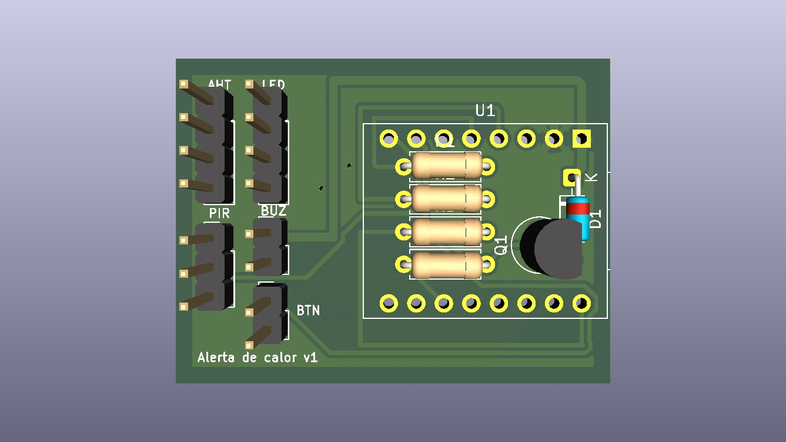
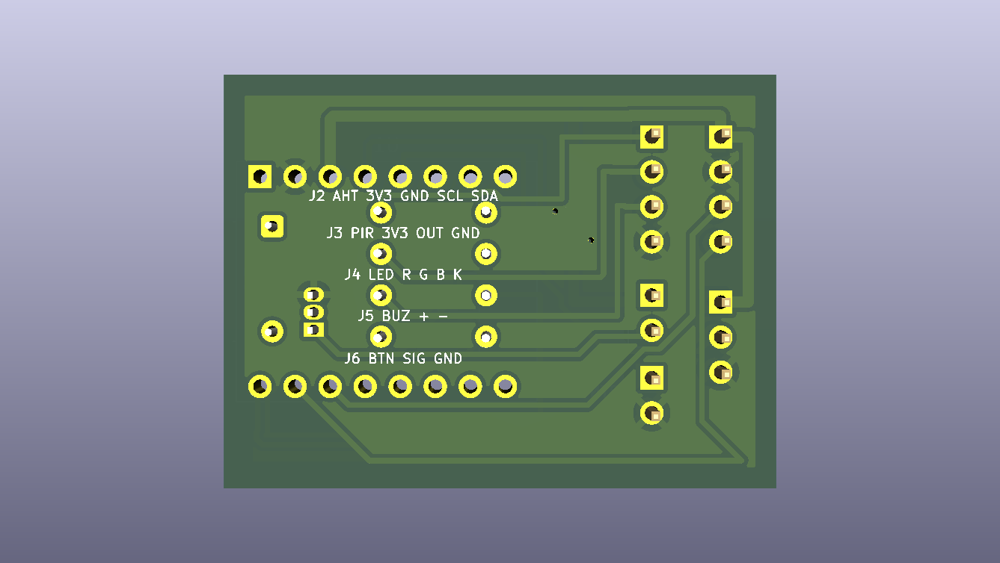

# Placa de circuito (KiCad)

Placa principal da caixa de alerta de calor, rev. 0.1, desenhada no KiCad 10.

  
  

## Resumo

| Item | Valor |
|---|---|
| Tamanho | 40 × 30 mm, 2 faces, 1,6 mm |
| Borda livre | 1,5 mm em volta (presilhas da tampa da caixa v4b) |
| Trilhas | 0,4 mm (sinais) e 0,8 mm (+5V, +3V3, GND), folga de 0,3 mm |
| GND | plano de cobre nas duas faces |
| Situação | roteada; DRC sem itens desconectados |

## Peças

| Ref. | Peça | Observação |
|---|---|---|
| U1 | ESP32-C3 SuperMini | em soquete fêmea 2 × 8 (fileiras a 15,24 mm); USB-C na borda direita. Vista de cima: 5V, GND, 3V3, GPIO4…0 na fileira de baixo; GPIO5…21 na de cima |
| R1, R3 | 220 Ω | LED vermelho e azul |
| R2 | 56 Ω | LED verde (mais fraco, resistor menor) |
| R4 | 1 kΩ | base do transistor |
| Q1 | BC337 (TO-92) | liga o buzzer |
| D1 | 1N4148 | protege o transistor |
| J2 a J6 | barras de pinos 2,54 mm | fios para os componentes da caixa |

R1–R4, Q1 e D1 ficam embaixo do ESP32, no vão do soquete. Na hora de soldar, o BC337 precisa ficar baixo, encostado na placa.

## Conectores

| Conector | Pinos (do 1 ao último) | Componente |
|---|---|---|
| J2 `AHT` | 3V3, GND, SCL, SDA | sensor AHT20 + BMP280 |
| J3 `PIR` | 3V3, OUT, GND | sensor de presença AM312 |
| J4 `LED` | R, G, B, K | LED RGB de catodo comum |
| J5 `BUZ` | +5V, − (coletor do Q1) | buzzer ativo 5 V |
| J6 `BTN` | SIG, GND | botão de silenciar |

O pino 1 de cada conector é o furo quadrado (fica embaixo em cada conector). A face de baixo da placa traz essa tabela impressa.

## Pinos do ESP32-C3

| GPIO | Uso |
|---|---|
| 3 / 4 / 5 | LED vermelho / verde / azul |
| 10 | buzzer (pelo BC337) |
| 6 / 7 | SDA / SCL do AHT20 |
| 0 | PIR |
| 1 | botão (pull-up interno) |
| 2, 8, 9 | livres (definem o modo de boot) |

## Como abrir

Abra `alerta_calor.kicad_pro` no KiCad 10. O símbolo e o footprint do ESP32-C3 SuperMini estão neste projeto (`alerta_calor.kicad_sym` e `alerta_calor.pretty/`), e as tabelas de bibliotecas já apontam para eles.

## Histórico

- 12/11/2026: a placa foi espelhada em Y. As fileiras do ESP32-C3 SuperMini estavam trocadas no footprint (conferido com a placa real). Trilhas, zonas e ligações são as mesmas, espelhadas; os conectores ficaram com o pino 1 embaixo.

## Pendências antes de fabricar

- Conferir com as peças reais a ordem dos pinos do AHT20 e do PIR, a distância entre as fileiras do ESP32 e as pernas do BC337.
- Definir se a placa será fabricada fora ou feita no IFAL. Para fazer no IFAL, trocar o footprint do Q1 por `TO-92_Inline_Wide` (o atual tem 0,22 mm entre as pernas).
- Gerar os arquivos de fabricação (Gerber e furação).
